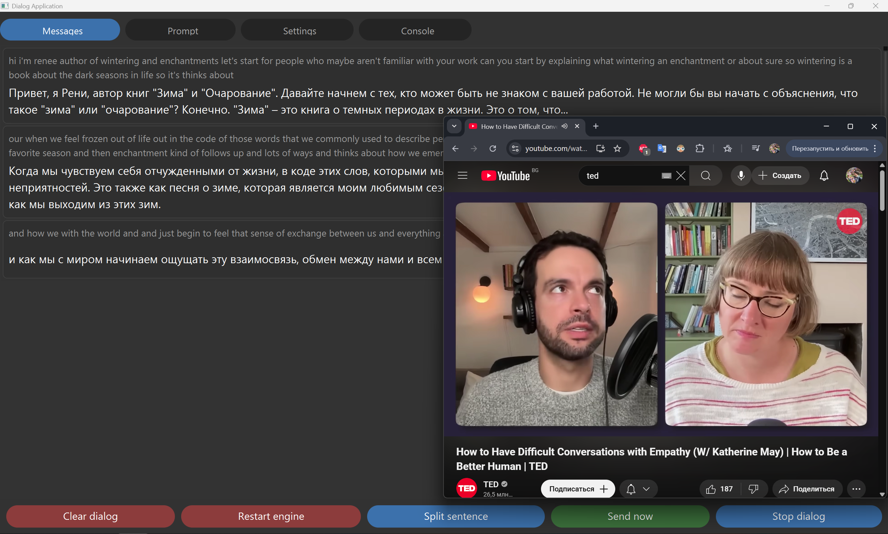
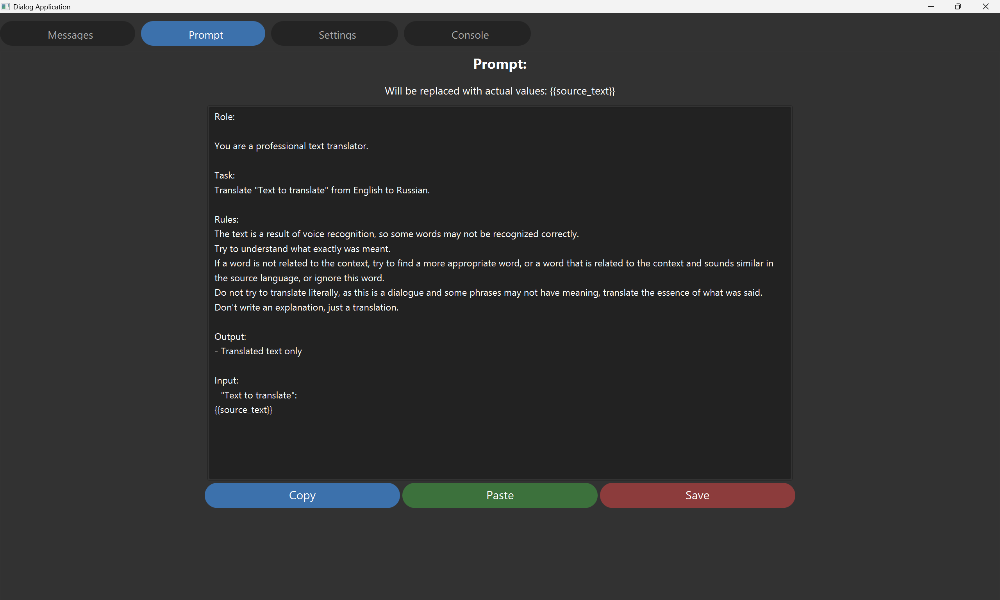
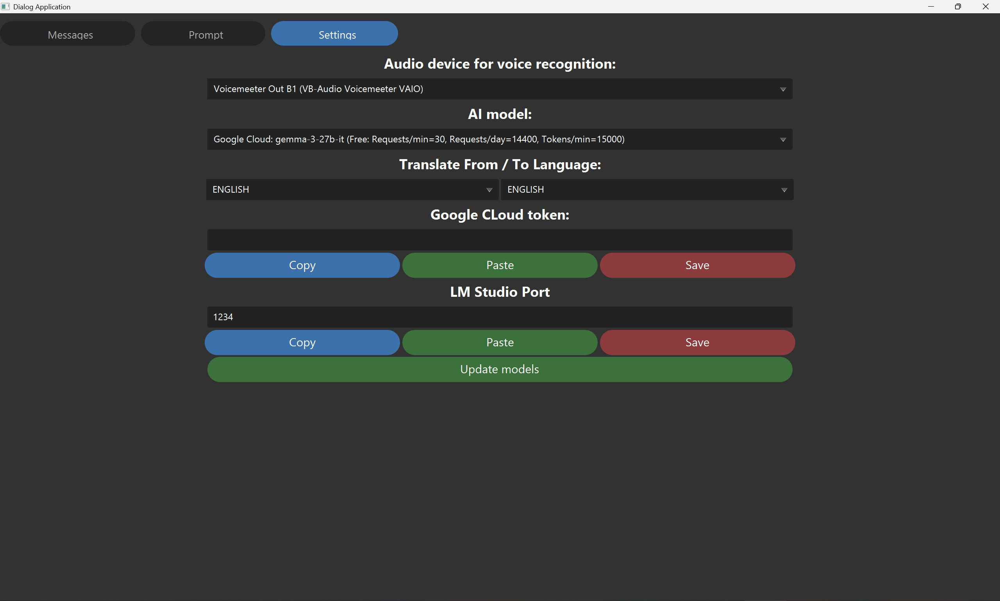

# Dialog AI Helper - PC Version

## What is this app for?

You can use this app to translate dialogue or to generate suggestions during a dialogue in real time.

The application's operation consists of 2 stages:

* **Voice recognition**: Recognize each sentence in a dialogue in a continuous mode

* **Sending to LLM**: Send the recognized text with a prompt to LLM models and receive streaming responses

## Translation methods and reserves

How each phrase becomes a translation is the **translation method**, chosen in **Settings → General** as up to three methods in order. A dialog starts on method 1; when the method in use fails — its model or its recogniser — the dialog switches to the next method at once and stays on it for the rest of the dialog. Stopping and starting the dialog begins with method 1 again, as does changing the methods or the keys. After method 3 there is nowhere to go: it stays, and a phrase it cannot translate says why on its row. The method in use is shown in the top bar after the token count (orange once the dialog has left method 1; its tooltip says why).

Each method is chosen on two levels. The first is **how the speech is heard**:

* **Voice** — a model that hears the audio itself, so no speech recognizer runs: each phrase, cut at pauses, goes to the model as audio together with the conversation summary and the previous phrases, and the model writes both what was said and its translation, streamed into the window. Phrases go one at a time in the order they were said, so each prompt carries the transcript of the phrase before it. Clear speech is transcribed accurately; on hard-to-hear audio the model, like Whisper, can mishear or paraphrase, and it is told to mark words it cannot make out as [?]. There is no second level: the same model translates.
  * **Gemini 3.5 Flash-Lite** — free tier, needs the Google API key. A phrase costs the instructions and context (about 1,000 tokens) plus 32 tokens per second of audio, and one of the 500 requests a day (summaries included); the answer starts in 1–2 seconds.
  * **GPT-Audio-1.5** — OpenAI's model that hears audio; paid, about half a cent a phrase (2–4 dollars an hour of dense conversation), the answer starts in about a second. OpenAI's regular models, GPT-6.1 Terra included, do not accept audio.
* **Recognition** — a [speech recognizer](#voice-recognition) turns the phrase into text, and the second level picks the [LLM model](#llm-models) that translates it.

Any method can be a reserve: when the dialog switches to it, the audio input is rebuilt for it — a voice model gets recorded phrases, a recogniser its own stream. A phrase already on its way when the switch happens is translated by the new method if it can take it (a recorded phrase by a voice model, text by a text model).

**What counts as a failure.** The request fails — a rate limit or used-up quota (HTTP 429), a rejected API key (401/403, or Google's 400 "API key not valid"), a missing model (404), any other rejected request (4xx), a server error or overload (5xx), a network error — no answer arrives, or the answer stops arriving, for 30 seconds, the answer is empty or not in the expected shape, the model's own rate limit would keep the phrase waiting more than 3 seconds, or the recogniser fails (Whisper cannot transcribe, the streaming process stops, Sherpa-ONNX or Speechmatics cannot start or loses its session). A method that cannot work at all when the dialog starts (no key, no model) is skipped the same way. "No speech" from a voice method is an answer, not a failure.

On Settings → General the method in use is outlined in green and the ones the dialog left in orange (the tooltip says why); the status line under the messages says when the dialog switched.

## Voice recognition

The recognizers a translation method can use on its first level (**Settings → General**):

| Engine | Where it runs | Notes |
|--------|---------------|-------|
| **Whisper batch** (default) | [faster-whisper](https://github.com/SYSTRAN/faster-whisper), one Python subprocess per chunk | Most accurate. Audio is split into chunks by silence detection and each chunk is transcribed one-shot. Needs a Whisper model + the Python `.venv`. |
| **Whisper streaming** | faster-whisper, one persistent Python process | Lower latency: audio is streamed in and sentences are committed while you speak. Same model + `.venv` as batch. |
| **Sherpa-ONNX** | in-process (no Python), CPU | Lowest latency, fully streaming, no subprocess. Uses a sherpa-onnx streaming model folder. |
| **Speechmatics** | Speechmatics cloud (realtime WebSocket), needs the Speechmatics key | Streaming, with speaker labels (S1, S2…) that the Questions mode passes on. Audio goes out only while someone speaks (billed by audio time); a pause ends the phrase. Region, model and speaker labels on **Settings → Speechmatics**. |

On silence and noise Whisper writes down phrases nobody said — "Thank you.", a lone "you", "Thanks for watching!", a subtitler's credit — learned from the video subtitles it was trained on; a study of Whisper on non-speech audio found them in 40% of its runs. Both Whisper modes drop an utterance made of nothing but such phrases, as silence (its row disappears, it never reaches a translation, the previous phrases or the summary), and keep once a sentence Whisper loops three or more times in a row. Each is noted in the log. A real, lone "Thank you." is dropped too; a "Thank you" with anything else in the utterance is kept.

### Whisper (batch & streaming) setup

1. Install the Python dependencies from `python/requirements.txt` into `python/.venv/` (CUDA-enabled PyTorch and `faster_whisper`).
2. Download a Whisper model (for example from [Hugging Face: faster-whisper](https://huggingface.co/Systran)) and unpack it to a folder.
3. In **Settings → Whisper**, select that folder as the **Whisper model folder**: **Browse…** fills the field, **Save** stores it.
4. In **Settings → General**, select an input audio device and the speech language code (e.g. `en`, `ru`).

If a CUDA-capable GPU is available, transcription runs on GPU automatically; otherwise it falls back to CPU.

### Sherpa-ONNX setup

1. Download a sherpa-onnx **streaming** model (e.g. `sherpa-onnx-streaming-zipformer-en-…` from the [sherpa-onnx releases](https://github.com/k2-fsa/sherpa-onnx/releases)) and unpack it.
2. In **Settings → Sherpa-ONNX**, set the model folder (it must contain the `encoder` / `decoder` / `joiner` `.onnx` files and `tokens.txt`).
3. Runs on CPU in-process — no Python needed. Tune segmentation with **Max words per phrase** and **Longest hang, ms** (force-finalize a phrase that has been hanging too long).

### Phrases (Settings → Phrases)

Where speech is cut into phrases. The three values serve Whisper (batch and streaming) and the voice models. Speechmatics uses the silence threshold and ends a phrase by itself after half a second of silence, so the longest phrase does not apply to it; Sherpa-ONNX finds the pauses itself.

| Parameter | Default | What it does |
|-----------|---------|--------------|
| Silence threshold, % | 10 | Volume level below which audio is considered silence |
| Pause that ends a phrase, ms | 500 | How long a silent gap closes the current phrase |
| Longest phrase, ms | 5000 | Hard upper bound on a single phrase's length |

### Whisper tuning (Settings → Whisper)

| Parameter | Default | What it does |
|-----------|---------|--------------|
| Max concurrent processes | 5 | How many transcription subprocesses can run in parallel (Whisper batch); the oldest is stopped beyond it |
| Streaming step, ms | 700 | How often Whisper streaming reads the speech again, so the phrase on screen updates as it is said |
| Streaming min characters | 20 | A sentence is sent on only once it is this long; a shorter one is joined with the next |

## LLM models

The app supports three streaming LLM backends via [langchain4j](https://docs.langchain4j.dev/):

Google's models are the ones that fit its free tier; for OpenAI and Claude only mid-tier models are listed — the flagships are slower and costlier than translation needs, the smallest tiers (Luna, Haiku) were weaker at recovering misrecognized words. Every model is asked to skip or minimise its reasoning, so the first words arrive quickly, and every answer streams into the Messages tab as it is generated.

* **Google AI** — the models that fit Google's free tier: Gemini 3.5 Flash-Lite (the default; text and voice) and Gemma 4 31B / Gemma 4 26B A4B (text).  
  Get an API key from [Google AI Studio](https://aistudio.google.com/app/apikey) (or enable the Gemini API in [Google Cloud Console](https://console.cloud.google.com/apis/api/generativelanguage.googleapis.com/) and use a [Cloud API key](https://cloud.google.com/docs/authentication/api-keys)).  
  Free-tier limits as AI Studio → Rate limit showed them in November 2026, which the app paces itself by (at 80% of the per-minute ones): Gemini 3.5 Flash-Lite — 15 requests/min, 500/day, about a second to the first word; Gemma 4 — 30 requests/min and 14,400/day but only 16,000 input tokens/min, which with the conversation context means roughly seven phrases a minute, and Gemma 4 31B took 10–25 seconds a phrase. Summary requests count against the same limits (about one per eight phrases). So the free tier covers about 12 phrases a minute and some 40 minutes of fast conversation a day on Flash-Lite; when speech outpaces the limit, or a day's quota is spent, the phrases go to a reserve method if you set one, and otherwise those that cannot be sent in time are marked "skipped" on screen, the status line saying why. Gemini 3.6 / 3.8 Flash are not listed: their free tier is 20 requests a day. A paid tier raises all of these limits.

* **OpenAI** — GPT-6.1 Terra (the mid tier of GPT-6, text), sent with reasoning effort `none`, and GPT-Audio-1.5 (voice only: it refuses a request without audio). GPT-6 Luna, the cheapest tier, is left out: in a test it translated misrecognized words literally where Terra recovered them; GPT-Audio Mini is cheaper but deprecated. Requires an [OpenAI API key](https://platform.openai.com/api-keys).

* **Anthropic Claude** — Claude Sonnet 5.5, with thinking switched off. Requires an [Anthropic API key](https://console.anthropic.com/settings/keys).

Paste the relevant API key into **Settings → API keys**; each model's request parameters are on **Settings → LLM**. Which model translates is chosen as a [translation method](#translation-methods-and-reserves) on Settings → General; add a second or third method on another provider and a model that hits its limits hands over by itself. A method saved in your settings whose model is no longer offered moves to its successor or, without one, falls back to the default; your other settings are kept.

## Settings from a `.env` file

Every field of the **Settings** screen can also be filled from a `.env` file in the project root —
handy for keeping API tokens out of the app's saved settings and out of git.

Copy `.env.example` to `.env` and fill in what you need. Each setting is resolved in this order:

1. the value saved in the app — wins whenever it is filled in
2. an OS environment variable of the same name
3. the `.env` file
4. the built-in default

So `.env` is a fallback, not an override: it supplies a setting while the corresponding field in
the app is still empty. The app only stores a setting you actually changed away from the `.env` /
built-in value, so editing `.env` and restarting takes effect for everything you have not chosen
yourself in the app. A setting you did choose keeps winning — to hand it back to `.env`, clear that
field in Settings and save. Whenever a `.env` key is overridden that way, the Console category says
so. `.env` is git-ignored; `.env.example` lists every key.

## Prompts and the conversation context

There is one prompt for each way a phrase is translated, and everything that reaches the model can be edited:

* **Settings → Main prompt** — a phrase a speech recognizer wrote down. Each phrase is one request: the **instructions**, the same for every phrase, go first as the system message; then the **message**, in which `{{summary}}` (the running summary of the conversation), `{{previous_phrases}}` (the phrases said just before, each with the translation already given, written in the **previous phrase format** with `{{said}}` and `{{translated}}`) and `{{phrase}}` (the phrase to translate) are filled in. The previous phrases are context only: the model is told never to translate them again, and they let it continue a sentence the pause split in two and recover words the recognizer misheard. The translation is natural spoken Russian — accurate but not word-for-word, consistent in names, terms and «ты»/«вы».
* **Settings → Voice prompt** — a recorded phrase a voice model hears itself: the same summary and previous phrases, with `{{audio}}` marking where the recording goes; the model answers with two lines, `<said>` and `<translated>`, which the app reads.

**The summary is a request of its own**, never part of a translation: it keeps what the previous phrases no longer show — the topic, who speaks and how they address each other, the Russian chosen for names and terms, the tone. It is first written as soon as a phrase leaves the previous phrases, then again each time the set number of phrases (**Rewrite the summary every … phrases**, 8 by default) has left them since. Each summary request gets the summary so far and those phrases and returns the new summary, by the model of the method in use when it reads text, else the first method of the chain that does; a failed one is tried again five phrases later. So every translation carries the summary plus the last few phrases (3 by default); between the two sit the phrases waiting for the next summary, up to about that number while each summary comes back before the next phrase (more while one is slow or has failed, or while an earlier phrase is still being recognised, until a summary takes them in); and a request stays around the same size however long the conversation runs. With no method in the chain that reads text, no new summary can be written: one already written keeps being sent, and besides it only the previous phrases are kept. The summary can be switched off; **Clear dialog** starts it over.

Every part has **Reset to default**; a part you never changed is not saved, so it follows the built-in text as the app improves. Save refuses a part that uses a placeholder it cannot fill or lacks the one that brings in its input. At the bottom of each prompt page the last request is shown exactly as the model got it, and Main prompt also shows the summary as it stands.

## Questions

**Questions** (the box in the top bar, left of Mic) suggests answers to the questions the other side asks you in a call. Every phrase heard (from the recogniser of the method in use, or a voice model's own transcript) also goes, with the last 8 phrases, the conversation summary and the questions answered so far, to a model chosen on **Settings → Questions** (GPT-6.1 Terra by default). The model answers a new question once it has been asked in full — in English, in the first person, two or three short sentences of plain text; several questions get one answer, and a follow-up ("why that order?") is answered knowing the earlier question and answer. The answers appear on the **Questions** screen next to Messages; a phrase without a question adds nothing there. A question still being asked waits for its end; if no phrase follows for 3 seconds the question is answered as it stands. If the other side goes on with a question after its answer has appeared (a recogniser without punctuation, such as Sherpa-ONNX, ends a phrase at every pause), the same row is answered again for the whole question instead of a second row being added. That happens only within 6 seconds of the phrase the answer was given on; anything said later is a question of its own and gets its own row. When both sides of the call are heard without speaker labels, your own first words can occasionally be taken for the other side's addition and rewrite the answer within those seconds; with speaker labels (Speechmatics) or only the other side heard this was not seen in testing. With Speechmatics' speaker labels each phrase carries who spoke. Settings → Questions holds the model, the number of phrases and kept answers, the prompt and the last request as it was sent; Clear dialog empties the screen and the history.

## Tabs

There are three top-level tabs (Questions is described above):

* **Messages** — the live loop: shows recognized speech and the model's streaming answer, with a status line underneath (recognition, translation, which method answers and why)
* **Settings** — a master-detail screen with a category sidebar:
  * **General** — translation methods 1–3 (how the speech is heard → which model translates), input device, speech language
  * **Phrases** — where speech is cut into phrases (silence threshold, the pause that ends a phrase, the longest phrase), used by Whisper and the voice models, and in part by Speechmatics
  * **LLM** — streaming-response toggle and each model's request parameters (temperature, top P / top K, max output tokens, thinking or reasoning effort, verbosity — only those the model accepts; an empty field takes its default, and the page shows what each request carries)
  * **API keys** — Google, OpenAI, Claude and Speechmatics keys
  * **Whisper** / **Sherpa-ONNX** / **Speechmatics** — per-recogniser model folder or endpoint & tuning
  * **Main prompt** / **Voice prompt** — everything the translation requests are made of (see [Prompts](#prompts-and-the-conversation-context))
  * **Console** — captures `stdout` / `stderr` from the running process for debugging

Right of the tabs, the same size and spacing, are **Start dialog** and **Clear dialog** (shown always, active on Messages and Questions), then the microphone and memory meters and the tokens the current dialog has used.

## Use for conferences

If you need to translate dialogue from a conference, route the conference audio into the app and to your speakers at the same time using a virtual audio cable. [VB-Audio VoiceMeeter Banana](https://vb-audio.com/Voicemeeter/banana.htm) works well for this.

## Additional information

* Tested only on Windows.
* PyTorch 2.11 (CUDA 12.8) + CTranslate2 4.8.0 is the tested GPU combination for the Python side; `python/requirements.txt` says why those two are held back.

## Future features

* Function calls via LangChain
* Refine-answer button — for each LLM answer

 

 
 
 
